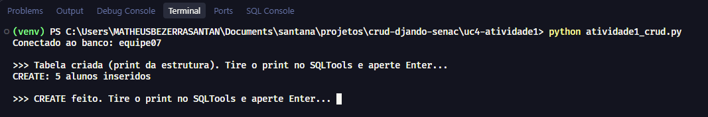
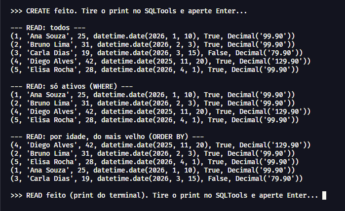
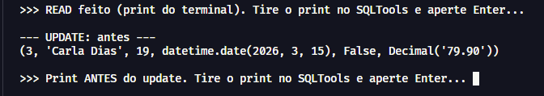
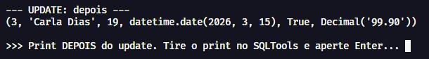
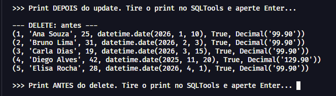
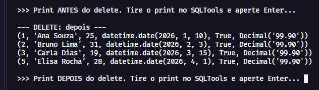
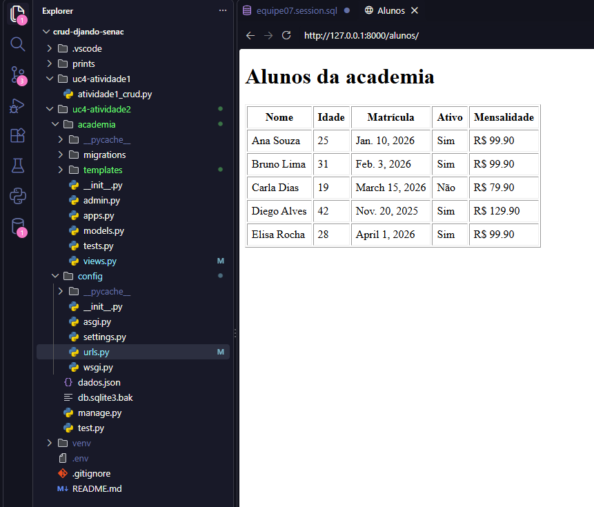
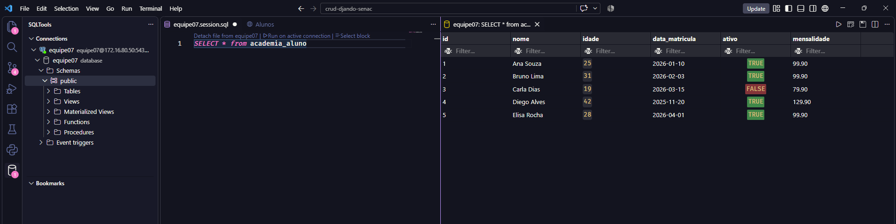

# UC4 – Implementar aplicações back-end · Equipe 07

Atividades 1 e 2: conexão de uma aplicação ao PostgreSQL do servidor da turma (banco `equipe07`).

- **Atividade 1:** CRUD em Python puro (`psycopg`) na tabela `alunos`.
- **Atividade 2:** projeto Django (app `academia`) migrado do SQLite para o PostgreSQL, com uma página que lista os alunos.

## Como rodar

1. Criar e ativar o ambiente virtual, depois instalar as dependências:

   ```powershell
   python -m venv venv
   venv\Scripts\Activate.ps1
   pip install django "psycopg[binary]" python-dotenv
   ```

2. Criar um arquivo `.env` na raiz, a partir do `.env.example`, com os 5 dados de conexão (`DB_HOST`, `DB_PORT`, `DB_NAME`, `DB_USER`, `DB_PASSWORD`). O `.env` fica no `.gitignore` e **não** vai para o GitHub.

## Atividade 1 – CRUD em Python (`uc4-atividade1/atividade1_crud.py`)

```powershell
cd uc4-atividade1
python atividade1_crud.py
```

**Conexão, criação da tabela e Create** (5 alunos inseridos):



**Read** (todos, com `WHERE` e com `ORDER BY`):



**Update, antes** (Carla Dias com `ativo = False`):



**Update, depois** (Carla Dias com `ativo = True`):



**Delete, antes** (5 alunos):



**Delete, depois** (Diego Alves removido):



## Atividade 2 – Django no servidor (`uc4-atividade2/`)

```powershell
cd uc4-atividade2
python manage.py migrate
python manage.py loaddata dados.json
python manage.py createsuperuser
python manage.py runserver
```

Os dados do SQLite foram exportados com `dumpdata` para `dados.json` e carregados no PostgreSQL com `loaddata`. O arquivo antigo foi renomeado para `db.sqlite3.bak`.

**Página `/alunos/`** lendo os registros do servidor:



**Tabela `academia_aluno` no SQLTools**, dentro do banco `equipe07`:


